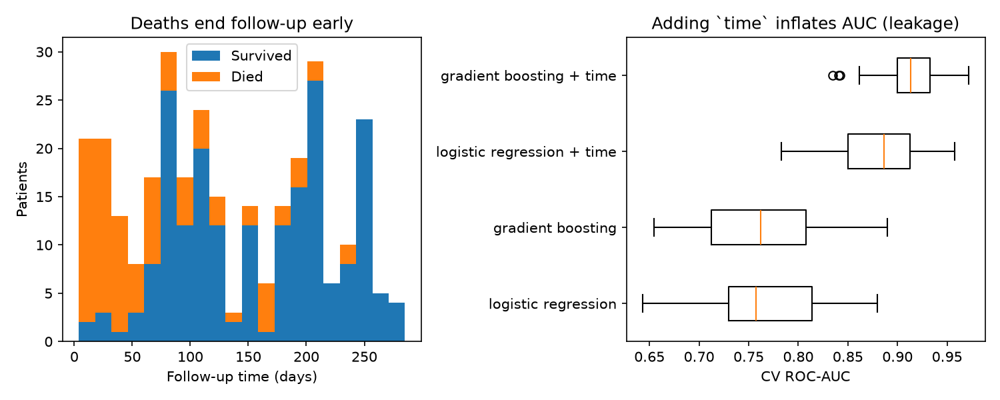
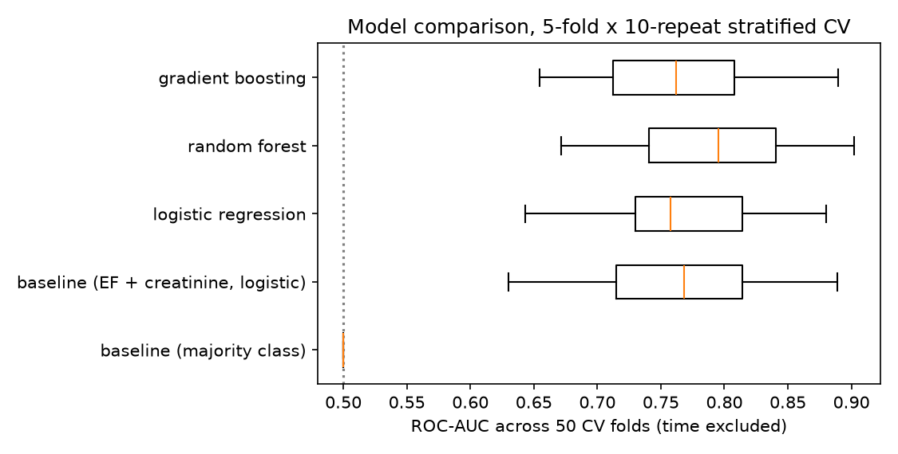
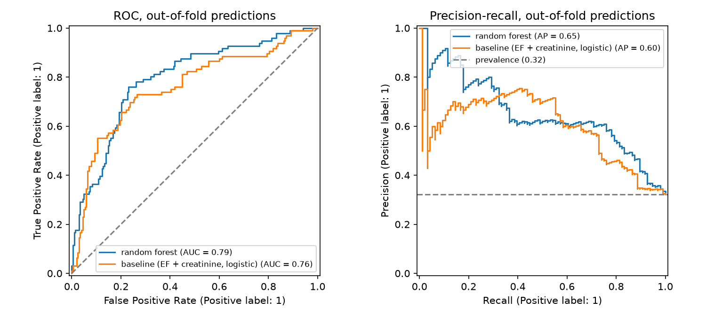
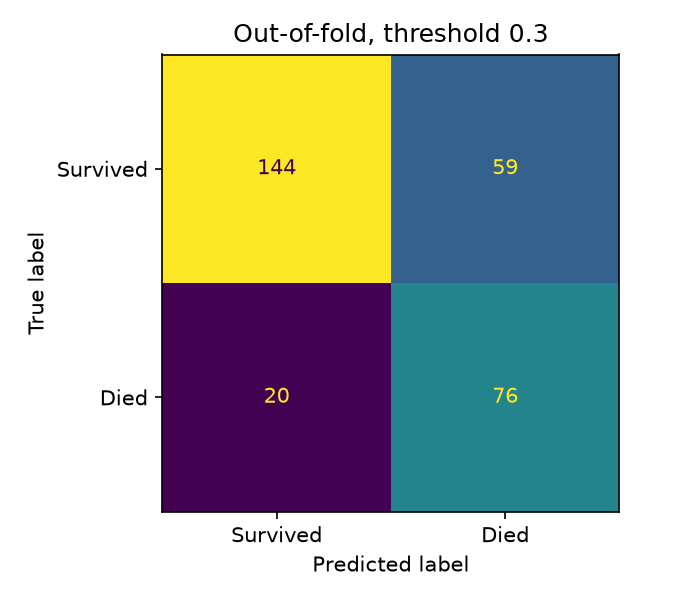
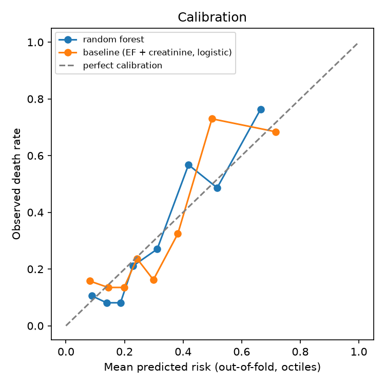
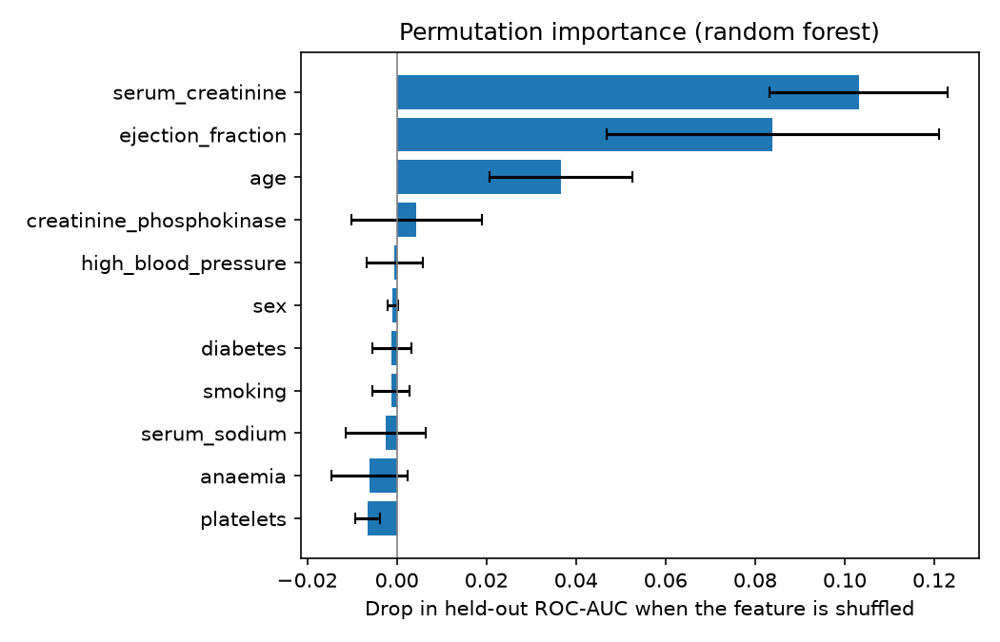
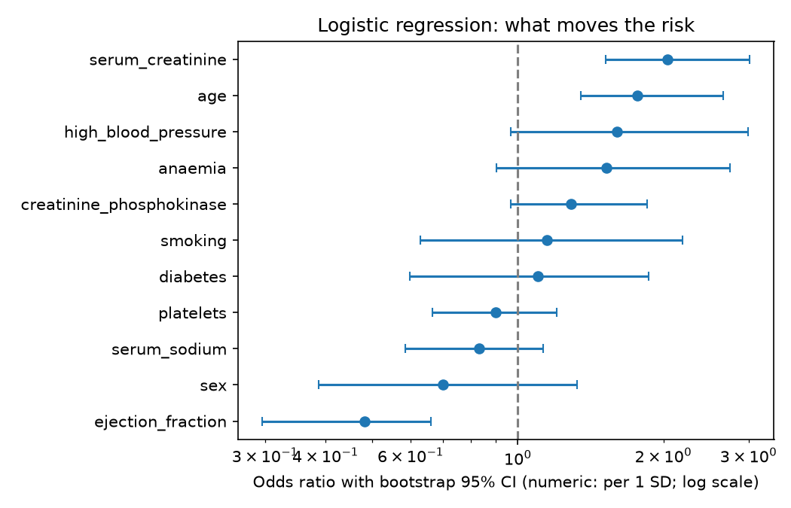

# Heart Failure Mortality Risk

Predicts whether a heart failure patient dies during follow-up from 11 baseline clinical measurements, with leakage-safe scikit-learn pipelines. The focus is on evaluation: baselines, repeated and nested cross-validation, bootstrap confidence intervals, calibration and an explicit check for target leakage.

**Result:** a random forest reaches an out-of-fold ROC-AUC of **0.79** (95% CI 0.74–0.85) and catches **79%** of deaths (CI 71–87%) at a 0.3 risk threshold. That is only modestly better than a two-variable clinical baseline (AUC 0.76, CI 0.70–0.82); the paired difference, +0.03 (CI −0.01 to +0.08), is not statistically clear.

## Data

- **Source:** *Heart failure clinical records*, UCI Machine Learning Repository, dataset id 519 ([download](https://archive.ics.uci.edu/static/public/519/heart+failure+clinical+records.zip)), licensed CC BY 4.0. The CSV in [`data/`](data/heart_failure_clinical_records_dataset.csv) is the unmodified file from that zip (SHA-256 `9c73cea7…dd75912`).
- **Citation:** Chicco D., Jurman G. *Machine learning can predict survival of patients with heart failure from serum creatinine and ejection fraction alone.* BMC Medical Informatics and Decision Making 20, 16 (2020).
- **Cohort:** 299 patients with heart failure (left ventricular systolic dysfunction) treated at the Faisalabad Institute of Cardiology and the Allied Hospital in Faisalabad, Pakistan, April–December 2015. Follow-up was 4–285 days.
- **Target:** `DEATH_EVENT` = 1 if the patient died during follow-up: 96 of 299 (32%).
- **Features (11):**
  - Numeric: age, ejection fraction (%), serum sodium.
  - Skewed lab values (log-transformed): creatinine phosphokinase, serum creatinine, platelets.
  - Binary: anaemia, diabetes, high blood pressure, sex, smoking.
- No missing values and no duplicate rows.

## Leakage: why `time` is excluded

The file has a 12th column, `time`: the length of follow-up in days. It is not a baseline measurement. It is only known once follow-up has ended, and for patients who died it *is* the time of death. The median follow-up is 45 days for patients who died and 172 days for survivors.

A model given `time` mostly learns "short follow-up means the patient died". In the same cross-validation:

| Model | ROC-AUC without `time` | ROC-AUC with `time` |
|---|---|---|
| Logistic regression | 0.764 ± 0.061 | 0.880 ± 0.044 |
| Gradient boosting | 0.762 ± 0.060 | 0.913 ± 0.032 |

That +0.12–0.15 is leakage, not skill: at the moment a prediction would be useful, `time` doesn't exist yet. So `time` is never a model feature:
- `data.load()` drops it unless asked for it explicitly, which only the leakage demo does.
- The prediction CLI ignores it.
- A test checks that no fitted pipeline sees it.



## Approach

1. **Evaluation design: repeated CV rather than a hold-out set.** With 96 deaths, a 20% test set would hold about 19. Its AUC would move by several points depending on which patients land in it. Instead:
   - Every model is scored with 5-fold × 10-repeat stratified cross-validation (50 folds) on all 299 patients.
   - The same folds are used for every model.
   - Each patient's out-of-fold probability is averaged over the 10 repeats. Every prediction comes only from models that never saw that patient.
2. **Preprocessing inside the pipeline.** Log transforms and scaling are fit on training folds only.
3. **Two baselines and three models:**
   - majority class (predicts the base rate),
   - a clinical baseline: logistic regression on ejection fraction and serum creatinine only, the two predictors the original study found most informative,
   - logistic regression,
   - random forest,
   - gradient boosting (XGBoost).

   Hyperparameters are fixed, conservative defaults (shallow trees, minimum leaf sizes), not tuned. Tuning on 299 rows mostly tunes noise.
4. **Model choice:** the simplest model whose mean CV ROC-AUC is within one standard error of the best, in the order logistic regression → random forest → gradient boosting.
5. **Nested CV** checks for optimism from picking the best of three models. The entire selection rule is re-run inside each outer training split (5-fold × 2 outer, 5-fold inner), and the model it picks is scored on the untouched outer fold.
6. **Reporting:**
   - ROC-AUC, PR-AUC and Brier score.
   - Recall, precision and specificity at a stated threshold.
   - Calibration: a plot, plus the intercept and slope of the calibration fit.
   - 95% percentile bootstrap CIs (2,000 resamples of patients) on the out-of-fold predictions, including a paired CI for the AUC gain over the clinical baseline.
7. **Threshold: 0.3.** It was fixed before looking at results: roughly the base rate, so a patient is flagged when their predicted risk is above average. Missing a death costs more than an extra review, so a threshold below 0.5 is the sensible default. [`reports/threshold_table.csv`](reports/threshold_table.csv) shows the trade-off at 0.1–0.6.

## Results

Cross-validation, mean ± SD over 50 folds (`time` excluded). Recall and precision are at threshold 0.3; the majority-class baseline predicts 0.32 for everyone, so it flags everyone:

| Model | ROC-AUC | PR-AUC | Brier ↓ | Recall | Precision |
|---|---|---|---|---|---|
| Baseline: majority class | 0.500 ± 0.000 | 0.321 ± 0.007 | 0.218 ± 0.002 | 1.000 | 0.321 |
| Baseline: EF + creatinine (logistic) | 0.762 ± 0.066 | 0.636 ± 0.110 | 0.177 ± 0.022 | 0.725 ± 0.084 | 0.550 ± 0.061 |
| Logistic regression (11 features) | 0.764 ± 0.061 | 0.632 ± 0.093 | 0.177 ± 0.025 | 0.722 ± 0.118 | 0.527 ± 0.061 |
| **Random forest** | **0.792 ± 0.062** | **0.672 ± 0.092** | **0.168 ± 0.019** | 0.780 ± 0.092 | 0.558 ± 0.056 |
| Gradient boosting | 0.762 ± 0.060 | 0.633 ± 0.094 | 0.180 ± 0.027 | 0.690 ± 0.111 | 0.556 ± 0.068 |



**Model choice.** The random forest has the highest mean AUC, and logistic regression is 0.028 behind. That gap is more than one standard error (0.009), so the rule picks the random forest. That SE treats the 50 folds as independent, though. They overlap, so the true uncertainty is larger, and the two models are closer than the rule suggests. Nested CV agrees: across the 10 outer folds the selection procedure picked the random forest 6 times and logistic regression 4 times. It scored **0.786 ± 0.046**, close to the non-nested 0.792, so selection added little optimism.

**Chosen model (random forest), out-of-fold predictions for all 299 patients:**

| Metric | Value | 95% bootstrap CI |
|---|---|---|
| ROC-AUC | 0.793 | 0.737 – 0.845 |
| PR-AUC (prevalence 0.32) | 0.652 | 0.557 – 0.746 |
| Brier score (majority-class baseline: 0.218) | 0.166 | 0.147 – 0.187 |
| Recall at 0.3 | 0.792 (76 of 96 deaths) | 0.708 – 0.869 |
| Precision at 0.3 | 0.563 | 0.479 – 0.646 |
| Specificity at 0.3 | 0.709 | 0.644 – 0.770 |
| AUC gain over EF + creatinine baseline | +0.034 | −0.011 – +0.080 |

<p float="left">
  
  
</p>

**Calibration.** The calibration slope is 1.29 and the intercept 0.19. A slope above 1 means the random forest's probabilities are too cautious: squeezed towards the middle, as is typical of forests. Averaging over 10 repeats squeezes them a little more. Rankings are unaffected. If the probabilities themselves were used, they would need recalibrating, e.g. with Platt scaling fit inside CV.



**What drives the risk.** Two complementary views agree.

Permutation importance for the random forest, measured as the drop in held-out AUC ([`reports/permutation_importance.csv`](reports/permutation_importance.csv)):
- Serum creatinine: AUC drops by 0.10.
- Ejection fraction: drops by 0.08.
- Age: drops by 0.04.
- Every other feature: about zero.

Odds ratios from the 11-feature logistic regression, with bootstrap 95% CIs ([`reports/odds_ratios.csv`](reports/odds_ratios.csv)):
- Higher serum creatinine raises the risk: OR 2.04 (1.52–3.02) per SD of log creatinine, i.e. per ~1.6× increase.
- Older age raises it: OR 1.77 (1.35–2.66) per 12 years.
- Higher ejection fraction lowers it: OR 0.48 (0.30–0.66) per 12 percentage points.
- Every other CI includes 1.

These are the same two markers the original study highlighted, plus age. They explain why the two-variable baseline is hard to beat.

<p float="left">
  
  
</p>

## Limitations

- **Small sample.** 299 patients and 96 deaths. CIs are wide (AUC 0.74–0.85), and the ranking between models is not stable: nested CV switched between the random forest and logistic regression.
- **Single city, single period.** All patients come from two hospitals in one city in Pakistan in 2015, with a 65/35 male/female split. No external validation was possible. Performance and calibration in other populations are unknown.
- **Survival is not modelled.** Follow-up length varies from 4 to 285 days, and `DEATH_EVENT` = 0 means "alive at the end of *this patient's* follow-up". A survivor followed for 30 days and one followed for 280 days count the same. A survival model (Cox or survival forests, with `time` used correctly as the outcome) would be the principled next step. This project answers a narrower classification question.
- **No out-of-sample estimate for the deployed model itself.** The saved model is refit on all 299 patients. Its expected performance is the CV estimate above.
- **Threshold.** 0.3 is a reasoned default, not a clinically validated cut-off.
- **Not for medical use.** This is a learning project.

## How to run

```bash
pip install -r requirements.txt
export PYTHONPATH=src          # Windows PowerShell: $env:PYTHONPATH="src"
python -m heart.train          # CV, nested CV, leakage demo, reports/ and models/ (about 1.5 min on 4 cores)
python -m heart.predict data/heart_failure_clinical_records_dataset.csv --threshold 0.3
pytest -q
ruff check src tests
```

`heart.predict` needs the 11 feature columns in any order. Extra columns such as `time` or `DEATH_EVENT` are ignored.

## Project structure

```
data/heart_failure_clinical_records_dataset.csv   input data (299 rows, UCI id 519)
src/heart/config.py      paths, feature groups, leaky column, threshold, seed
src/heart/data.py        loading, schema checks, column validation
src/heart/model.py       pipelines: baselines, logistic regression, random forest, XGBoost
src/heart/evaluate.py    metrics, bootstrap CIs, calibration slope/intercept
src/heart/train.py       repeated + nested CV, model choice, leakage demo, reports, figures
src/heart/predict.py     scoring new patients from a CSV
tests/                   data schema, no-`time` guard, pipelines, CLI column order, metrics
reports/                 metrics.json, cv_results.csv, threshold_table.csv,
                         odds_ratios.csv, permutation_importance.csv, figures/
```

## Tools

Python · pandas · scikit-learn · XGBoost · Matplotlib · pytest · ruff · GitHub Actions
